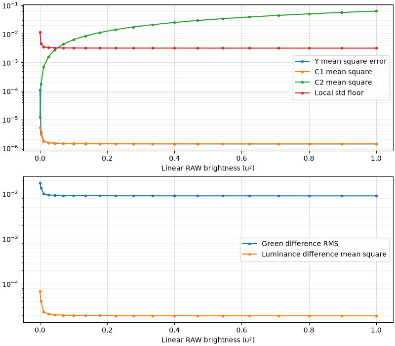

# Handheld Multi-Frame Super-Resolution

[[Paper]](https://www.ipol.im/pub/pre/460) [[Demo]](https://ipolcore.ipol.im/demo/clientApp/demo.html?id=460)

**⚠️ Update 02/09/26:This repo now diverges considerably from the online IPOL demo and paper. Several correction have been made to better fit the real pipeline. Please try the recent code for better result**

This repository contains a non-official implementation of the “Handheld Multi-Frame Super-Resolution algorithm” paper by Wronski et al. (first used in the Google Pixel 3 camera), which performs simultaneously multi-image super-resolution demosaicking and denoising from a burst of raw photographs. To the best of our knowledge, this is the first publicly available comprehensive implementation of this well-acclaimed paper, for which no official code has been released so far.

You can read more about the method in their [official SIGGRAPH publication](https://sites.google.com/view/handheld-super-res/), as well as our [IPOL publication](https://www.ipol.im/pub/pre/460) detailing our experiments and analysis of the pipeline. In this companion publication, we fill the implementation blanks of the original SIGGRAPH paper, and disclose key details implement the method.
Note that this repository evolved considerably after the IPOL publication, in order to match even more faithfully
the original pipeline.

We hope this code and the details in the IPOL publication will help the image processing and computational photography communities, and foster new top-of-the-line super-resolution approaches. Please find below two examples of demosaicking and super-resolution from a real raw burst from [this repository](https://github.com/goutamgmb/deep-rep).


#### Post-processing

In the examples above and in our IPOL paper, we used the post-processing approach of this [repo](https://github.com/teboli/fast_two_stage_psf_correction) to remove the remaining optical aberrations on the following examples.
Check also our publicly available implementation of **Polyblur** in this [repo](https://github.com/teboli/polyblur) to sharpen the result you get with this super-resolution code.

## Implementation / Compatibility

The main routine is implemented in Python.
The alignment module is implemented in Halide and compiled to run on CPU.
Some steps are implemented as compute shaders using Slang. They are compiled on-the-fly by SlangPy and are very portable.
These steps require an integrated or discrete GPU compatible with a SlangPy backend such as Vulkan, Metal, or CUDA.
> The code cannot run with the "CPU" backend of Slangpy, which does not support textures.

## Installation
>
> ⚠️ **Windows users:** We recommend using WSL.

### From wheel

Coming soon...

### From source

Installing from source compiles the alignment extension specifically fro your CPU.

```bash
# uv
uv sync

# pip
python -m venv .venv
source .venv/bin/activate
python -m pip install -e .
```

To build a wheel targeting the architecture's baseline CPU features (more portable):

```bash
python -m pip wheel . --no-deps --wheel-dir dist -Ccmake.define.ALIGNMENT_HALIDE_TARGET=cmake
```

### Running the code

Run the code for x2 super-resolution with:

```bash
# uv
uv run handheld --impath your_burst --outpath output.png --scale 2

# pip
handheld --impath your_burst --outpath output.png --scale 2
```

Run `uv run handheld --help` or `handheld --help` to see all the options. The `--debug` flag will dump interesting intermediate results.

When either robustness or kernel noise correction is enabled, you must provide the matching LUT with
`--noise-model.lut-path data/your_camera_noise.npz` (see below).
To obtain the bursts used in the publication, please download the latest release of the repo. It contains the code and two raw bursts of respectively 13 images from [[Bhat et al., ICCV21]](https://arxiv.org/abs/2108.08286) and 20 images from [[Lecouat et al., SIGGRAPH22]](https://arxiv.org/abs/2207.14671). Otherwise specify the path to any burst of raw *.dng* images.

## DNG output

Saving as DNG uses an uncompressed 16-bit TIFF intermediate, ExifTool for
metadata, and Adobe's `dng_validate` to produce the final LinearRaw DNG.

Install ExifTool and the build dependencies:

```bash
sudo apt update
sudo apt install -y libimage-exiftool-perl build-essential gcc g++ make unzip libjpeg-dev
exiftool -ver
```

Adobe does not distribute a Linux binary for `dng_validate`. The tested route
uses the community Linux build from
[`abworrall/go-dng`](https://github.com/abworrall/go-dng):

```bash
git clone https://github.com/abworrall/go-dng.git
cd go-dng/sdk/
```

Now, try a first install

```
make CC=g++ CXX=g++
```

No need to run it until the end, we just need it to download a zip. You can now run

```
unzip dng_sdk_1_6.zip
```

The SDK validator normally attempts to generate JPEG previews, which fails for
large output images. Disable its preview loop before compiling:

```bash
sed -i 's/previewIndex < 2/previewIndex < 0/' \
  dng_sdk_1_6/dng_sdk/source/dng_validate.cpp
make CC=g++ CXX=g++
./bin/dng_validate
```

Say **no** when `make` asks whether to replace the already-extracted SDK files. Put
`go-dng/sdk/bin` on `PATH`, or link it:

```
sudo ln -s "$(pwd)/bin/dng_validate" /usr/local/bin/dng_validate
```

You should now be able to execute `dng_validate` from anywhere. And you can now use

```bash
# uv
uv run handheld --impath test_burst --outpath output.dng

# pip
handheld --impath test_burst --outpath output.dng
```

### Calibrating noise correction for more robustness



Generate the noise lookup table for your sensor, using a representative DNG (or supply --alpha and --beta).
The default is 10 signal points with 4096 trials each. Override with `--points` and `--samples-per-point`.

```bash
# uv
uv run python -m handheld_super_resolution.monte_carlo \
  --dng your_image.dng \
  --output data/noise.npz

# pip
python -m handheld_super_resolution.monte_carlo \
  --dng your_image.dng \
  --output data/noise.npz
```

This will also generate the curves as shown above. Once generated, use the LUTs using:

```bash
# uv
uv run handheld \
  --impath test_burst/vk \
  --outpath output.png \
  --noise-model.lut-path data/noise.npz

# pip
handheld \
  --impath test_burst/vk \
  --outpath output.png \
  --noise-model.lut-path data/noise.npz
```

The loader rejects LUTs made for a different transform or a different DNG noise profile. To run without the correction, pass `--robustness.no-noise-correction --merging.kernel.no-noise-correction`. In this mode you may omit the LUT path.

## About the noise profile

The method requires the camera noise profile $\alpha,\beta$.

By default, the program reads the `noise profile` tag of the dng stack. If these values are unavailable or inaccurate, you can provide your own values of $\alpha$ and $\beta$.
If the stack was captured using a smartphone, the noise profile of the Pixel 4 can give good results :

```python
    alpha = 1.80710882e-4 * ISO / 100
    beta = 3.1937599182128e-6 * (ISO / 100)**2
```

For better results, determining the accurate noise profile of your device can be done using tools [such as this demo](https://www.ipol.im/pub/art/2013/45/)

## Citation

If this code or the implementation details of the companion IPOL publication are of any help, please cite our work:

```BibTex
@article{lafenetre23handheld,
  title={Implementing Handheld Burst Super-Resolution},
  author={Lafenetre, Jamy and Facciolo, Gabriele and Eboli, Thomas},
  journal={Image Processing On Line},
  year={2023},
}
```

## Troubleshooting

If you encounter any bug, please open an issue and/or sent an email at <jamy.lafenetre@ens-paris-saclay.fr> and <thomas.eboli@ens-paris-saclay.fr>.
